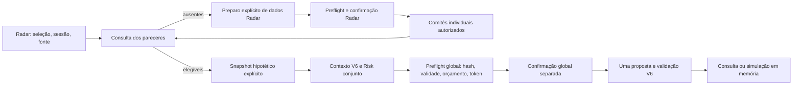

# HFL Premium V7 — arquitetura da plataforma local

A V7 consolida navegação, consulta e solicitação explícita de propostas. O servidor
Python e o JavaScript existentes continuam sendo a stack. Os runners anteriores
continuam responsáveis pelos contratos científicos, decisões e contabilidade.

## Arquitetura de informação

| Grupo | Áreas e URLs |
|---|---|
| Visão Geral | `/`, `/#wallets`, `/#readiness`, `/#audit` |
| Operação | `/paper#sala`, `/paper#visao`, `/paper#carteiras`, `/paper#supervisao`, `/paper#mercado` |
| Laboratório | `/radar`, `/portfolio#global-workflow`, `/paper#agentes`, `/portfolio#ai-proposal` |
| Pesquisa e Auditoria | `/h2`, `/#audit`, `/logs`, `/legacy` |

As URLs `.html` e as entradas antigas `/h2`, `/paper`, `/radar`, `/portfolio`,
`/logs` continuam funcionando. `/index.html` e `/legacy` mantêm o export legado.
Somente `/` passa a abrir a visão operacional. Hashes locais continuam sendo
resolvidos pelos módulos originais; `#supervisao` abre a Sala e foca seu painel.

`dashboard/server.py` injeta `shell.html` nas páginas com o marcador de shell.
`shell.css` define cores, tipografia, foco, tabelas e navegação responsiva;
`shell.js` controla o menu por teclado e indica a área atual. Os estilos e
scripts específicos continuam separados. Chart.js é o vendor local já instalado;
fontes e gráficos não precisam de CDN. O legado usa datasets Chart.js nativos
para os níveis RSI 30/70.

## Ambientes e autoridades

| Ambiente | Autoridade | Limite |
|---|---|---|
| HISTÓRICO CIENTÍFICO | manifesto H2 v6, evidências OA-1, `h2_api.py` | Validation provisória; ratificação acadêmica pendente; Final Test bloqueado |
| PROSPECTIVO REAL — PAPER | `run_h2_v6_forward.py`, `run_h2_v6_supervised.py`, `run_h2_v6_forward_benchmarks.py` | PETR4, dados oficiais, patrimônio virtual independente por estratégia |
| CONSULTIVO COM GEMINI | Radar V4 e Global PM V6 | chamadas pagas explícitas e separadas; nenhuma execução financeira multiativos |
| DEMONSTRAÇÃO SINTÉTICA | Radar `demo-v4`, ledger `demo-qualified-v5`, exemplos V6 A–F | dados/respostas roteirizados; sem interpretação como resultado real do Gemini |

Identidades: H2 v6 mantém seu manifesto e participante; Radar usa
`HFL-MULTIASSET-RADAR-V1`; V5 usa `HFL-MULTIASSET-PORTFOLIO-V1`; V6 usa
`HFL-MULTIASSET-GLOBAL-PM-V1`. `HFL-PLATFORM-V7` identifica a projeção de produto,
sem criar tratamento científico ou estratégia financeira.

As cinco carteiras prospectivas são IA H2 v6, Buy & Hold, SMA Regime 50/200,
Bollinger Estado 20/2 e H2 v6 Supervisionada. Cada uma tem ledger e capital
próprios. A landing mostra cada patrimônio, caixa, exposição, retorno, custos,
posições, operações, marcação e pendência separadamente. Não calcula patrimônio
conjunto nem usa os valores V5/V6 como substitutos.

## Responsabilidades dos runners

| Componente | Responsabilidade exclusiva |
|---|---|
| `run_h2_v6_forward.py` | preparo oficial, preflight, inferência H2 e reconciliação na rotina original |
| `run_h2_v6_supervised.py` | proposta supervisionada, ação humana vinculada ao hash/prazo, limites, reconciliação, verificação |
| `run_h2_v6_forward_benchmarks.py` | SMA/Bollinger determinísticos em ledgers próprios |
| `multiasset_radar.py` / `run_multiasset_radar.py` | universo ≤5, dados, cinco votos por empresa, Risk individual, orçamento/claims/journal/replay |
| `multiasset_portfolio.py` / `multiasset_manager.py` / `run_multiasset_portfolio.py` | contratos V5, caixa/reservas/recebíveis, validação, projeção e demonstração contábil |
| `multiasset_global_pm.py` / `run_global_pm.py` | contexto e snapshot hipotéticos, opiniões elegíveis, Risk conjunto, uma proposta global, validação e journal durável |
| `dashboard/platform_api.py` | projeções somente leitura e jobs que invocam explicitamente prepare/run/replay do Global PM existente |
| `scripts/check_platform.py` | diagnóstico offline somente leitura por seção (`--json` completo), stdout UTF-8 e exit code 2 para integridade H2 ausente/divergente |
| `scripts/radar_corporate_events.py` | V7.2: normalizador de bonificação confirmada pela B3 (ESPECI + DISMES); `install()` o torna o extrator padrão do Radar no processo — chamado por `server.main()` e pelo CLI `prepare`, mesmo caminho do botão; diagnóstico por ticker |
| `scripts/check_preservation.py` | V7.2: política de ciclo de vida; baselines históricos classificados em OPERATIONAL / LEDGER / VIOLATION, e antes/depois (`--snapshot`/`--since`) de uma operação autorizada |

O catálogo permanece o existente: cinco Technical Analysts ativos e 25
slots técnicos livres (30 no total), mais Risk e Portfolio Manager. Nenhum agente novo é criado. A
Sala prioriza fluxo coletivo, quórum, evidências, Risk, Portfolio, intenção e
supervisão; os votos individuais ficam em um disclosure expansível.

## Fluxos

O link Radar → Global PM transfere tickers selecionados, sessão e modo por URL.
O retorno ao Radar preserva os mesmos parâmetros. GET não altera universo,
prepara input, inicia modelos nem grava snapshot. O preparo global consulta
os pareceres conjuntamente: mesma fonte, sessão, integridade, cinco votos,
histórico suficiente e observação sem lookahead. Fontes oficiais e sintéticas
usam raízes fixas separadas; não existe fallback de oficial para demo.

O formulário V7 cria um snapshot novo de caixa informado, sem posições, reservas
ou recebíveis, mediante dois reconhecimentos explícitos. Snapshots completos
continuam disponíveis pelo CLI V6. Cada análise recebe `v7-<uuid hex>` e contexto
imutável em `data/global_pm/hfl_global_pm_v1/`. A validade é de 24 horas desde o
preparo. Mudanças de seleção, sessão, fonte ou capital invalidam o preflight e
o consentimento; orçamento invalida o token apresentado. Inputs ficam bloqueados
durante o job. Respostas assíncronas antigas não habilitam uma análise diferente.

No modo sintético, a V7 usa o fake E existente (manter todo o caixa, zero
operações). A conversão dos preços sintéticos segue o CLI V6, preservando os
pareceres originais. Exemplos A–F anteriores continuam intactos e consultáveis.

## API e segurança

As famílias `/api/h2/*`, `/api/forward/*`, `/api/radar/*`, `/api/portfolio/*` e
`/api/global-pm/*` mantêm seus contratos. A API V6 original continua somente
leitura; os novos comandos explícitos ficam em `/api/platform/`.

| Endpoint novo | Método / efeito |
|---|---|
| `overview`, `readiness` | GET sem parâmetros; projeção de carteiras, decisão, supervisão, calendário, dados, integridade, jobs, próximos passos |
| `jobs` | GET sem parâmetros; jobs públicos e contextos V7 existentes |
| `global?id=` | GET; detalhe público V6 de uma análise V7 |
| `global-preflight?id=&max_usd=` | GET; preflight nativo sem reserva, claim ou chamada |
| `radar-view?mode=` | GET; status da raiz oficial/sintética fixa |
| `radar-detail?mode=&ticker=&session=` | GET; parecer público da mesma raiz |
| `radar-readiness?session=&tickers=` | GET; por ticker oficial: input congelado, normalização, risco individual, parecer, preflight e próxima ação; resumo "N inputs prontos; k/N pareceres oficiais" (sem gravar nem inferir) |
| `global-prepare` | POST; ID, modo, sessão, tickers, capital e reconhecimentos explícitos |
| `global-run` | POST; ID, orçamento, token do preflight, autorização paga própria e confirmação |
| `global-replay` | POST; ID e confirmação; exige claim e journal existentes, sem chamada nova |

Servidor loopback `127.0.0.1`, Host exato, Origin da mesma origem, proteção
Sec-Fetch-Site e CSRF existente. POSTs V7 aceitam somente JSON de até 4096 bytes,
campos exatos, sem duplicatas ou constantes não finitas; queries duplicadas e
IDs/caminhos arbitrários são recusados. Nenhuma string de comando ou subprocesso
novo é construído. A chave fica somente no backend e não é lida pela landing.

Jobs V7 ficam em `data/platform/v7`, com publicação atômica e selo; comandos
duplicados são recusados. O runner V6 conserva locks de processo/identidade,
reserva conservadora, autorização, claim, SQLite/envelope e resultado durável.
Uma falha depois do claim exige recuperação offline; não há retry automático,
limpeza de claim ou liberação de reserva incerta. O mutex local serializa os
jobs desse servidor; a exclusão entre processos e a proibição de chamada
duplicada são do runner nativo. Este desenho é para um laboratório local.

Os estados visuais comuns mapeiam os estados nativos, que permanecem expostos:
NOT_PREPARED, PREPARED, READY, RUNNING, COMPLETED, FAILED, RECOVERY_REQUIRED,
EXPIRED, BLOCKED e DECISION_EXISTS. Estado desconhecido fica bloqueado. Um job
RUNNING de outro processo encerrado é apresentado como recuperação necessária,
sem reescrever seu arquivo. Custos não observados aparecem como N/D.

Observabilidade usa allowlists públicas. Prompts privados, envelopes, SQLite,
credenciais e exceções brutas do provider não são publicados pelos endpoints
novos. O log técnico original permanece separado. A consulta agregada verifica
identidade e hashes H2 registrados, auditoria supervisionada, comparabilidade
dos benchmarks e status dos módulos. O inventário completo é uma qualificação
offline separada, não uma segunda autoridade contábil.

## Preservação, operação e limites

A [auditoria inicial](HFL_PLATFORM_AUDIT_V7.md) precedeu o código. O
[baseline V7](evidence/hfl_platform_v7/preservation_baseline.json) protege
11.094 arquivos, incluindo `src/`, decisões, claims, ledgers, evidências e
implementações seladas V4–V6. Nenhum desses arquivos é movido ou reescrito.
Validation e Final Test não são executados; a projeção científica consulta
somente o status e as fontes de Validation já permitidas por `h2_api`.

O [runbook](HFL_OPERATIONS_RUNBOOK.md) define o ciclo manual. A V7 não inclui
scheduler, migração, banco novo, autenticação pública, execução financeira
multiativos ou acompanhamento automático de preço. O calendário é previsão,
não confirmação de leilão. Não há cotação intradiária no diagnóstico offline.
Os pareceres oficiais das cinco empresas ainda estão ausentes/incompletos;
ITUB4 tem um bloqueio de consistência entre fontes já registrado no Radar.
Resolver dados e autorizar custo permanece trabalho explícito do operador.
